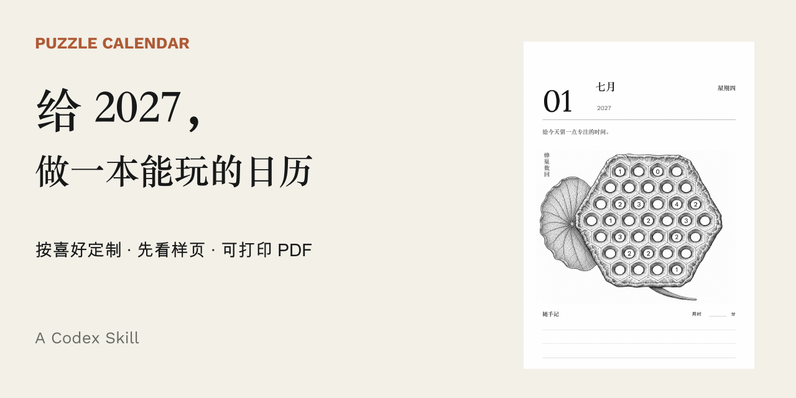

# Puzzle Calendar · 可定制谜题日历 Skill

**先了解你的用途与喜好，再用真实样页确定风格，制作适合纸笔解谜的日历 PDF。** 适用于 Codex，技能版本 **2.3.5**。

[下载三页试玩包](demo/trial-bundle.zip) · [先生成一张 PDF](examples/README.md) · [安装技能](#安装技能) · [提交体验反馈](docs/feedback.md)


## 先玩几页

试玩包包含 **2027 年 7 月 1日至3日** 三页 A5 黑白日历：莲蓬蜂巢数回、圆形迷宫、无框桥梁。题页顶部保留20毫米装订空白，底部有连续随手记空间。它是三日样本，不是完整一月或全年成品。

- [日历题页 PDF](demo/trial-calendar-A5.pdf)：不含答案。
- [玩法与打印说明 PDF](demo/trial-rules-A5.pdf)：附100毫米校准线。
- [独立答案 PDF](demo/trial-answers-A5.pdf)：按日期对应，准备核对时再打开。

打印选择 **A5、实际大小／100%、单面**。先试印一页，检查细线和铅笔痕迹；实物打印与真人难度仍待试用反馈。

## 它适合做什么

**按喜好设计。** 不知道喜欢什么也可以从比较开始；先看样页，确认后再制作当前月份或范围。

**让题盘参与造型。** 蜂巢可形成莲蓬，迷宫可采用圆形通道，桥梁可省去装饰外框。优先让题面本身有主题感，“解答后显现”只作少量点缀。更多造型是设计储备，不能把每个方向都当成已内置按钮。

**为真正使用而安排。** 日期、作答区域、随手记、玩法与答案一起考虑；每道题按相应方法核验，PDF结构、实际视觉效果与实物打印分别记录。

## 先生成一张 PDF

[入门示例](examples/README.md) 只需 **Python 3.11+、Node.js 和 ReportLab**，使用仓库自带的圆形迷宫代码；不要求先配置外部多题型引擎。

下载或克隆本仓库，在根目录执行：

```bash
python3 -m pip install -r examples/requirements.txt
python3 examples/first_calendar.py --date 2027-07-02 --output ./my-first-calendar
```

得到日历、答案和玩法三个PDF。默认英文，便于在没有中文字体的新环境先运行；传入可嵌入中文字体可切换中文。这个示例验证最小制作路径，不代表完整日历任务已经配置好全部题型与信息来源。

## 安装技能

下载 [puzzle-calendar-skill.zip](puzzle-calendar-skill.zip)，解压后把 `puzzle-calendar/` 放入 Codex 的 skills 目录（默认 `~/.codex/skills/`）。已有同名技能时先保留自定义内容，再决定替换。

在新对话中调用 `$puzzle-calendar`，例如：

> 用 puzzle-calendar 制作2027年7月的成人谜题日历，A5黑白，顶部预留装订空白，有随手记空间。先给我比较样页，确定风格后再继续整月。玩法和答案单独提供。

## 当前能力与依赖

| 内容 | 当前情况 |
| --- | --- |
| 日期计划、任务记录、PDF排版与交付检查 | 已有脚本；按具体纸幅、题量与模块组合核对 |
| 原生谜题与常规PDF链路 | 另需 `puzzle-publisher`、ReportLab、pypdf及中文字体 |
| 扩展题型 | 需配置外部生成／求解依赖；有题型名称不等于任意规格稳定量产 |
| 蜂巢／三角数回、圆形迷宫、无框桥梁 | 有独立入口与实例级验证；尚未全部并入自动年度轮换 |
| 农历、节气、节假日、引语及个人排盘 | 按用户选择取得数据／工具并核对，不凭空生成事实 |
| 二维码图形答案 | 可选使用本人账户托管；需核对当前站点、日期映射与实际扫码 |

完整说明：[技能入口](puzzle-calendar/SKILL.md) · [运行能力](puzzle-calendar/references/runtime.md) · [题盘形态](puzzle-calendar/references/puzzle-forms.md) · [任务续做](puzzle-calendar/references/workflow.md)。文档中的开发机器路径是历史接入记录，换环境需重新定位。本仓库未附全部外部引擎或商业中文字体。

## 反馈与参与

欢迎反馈安装问题、第一张PDF的生成情况、规则是否易懂、打印与书写体验，也欢迎展示你做出的样页。请使用 [反馈模板](docs/feedback.md)，不用先点 Star 才能下载或提问。

如果这套方法对你有帮助，可以 Star 关注后续更新。更欢迎带回一张真实作品，或帮助完善一个明确的题型／版式适配。

## 验证与素材说明

- 2.3.3基线完成98项现有回归测试；2.3.4和2.3.5是设计文档更新，完成格式、链接和分发一致性检查。
- 本次三日试玩重新验解：蜂巢数回、桥梁验证答案满足规则且无第二解；圆形迷宫独立BFS与引擎通路一致。实际PDF已检查页幅、字形、题目答案对应及版面。
- 首次运行示例已在开发机器的独立目录运行中英文输出；尚不等于所有用户环境均通过。
- 莲蓬图案使用AI辅助创作；日期、文字、准确题线与答案由结构数据排入。宣传图展示真实PDF渲染，未冒充实物照片。
- 目前尚未加入项目级开源许可证；随包字体与圆形迷宫代码分别保留OFL／MIT许可。第三方许可不自动覆盖整个项目。

## 宣传与分享

[查看首发六图](media/launch/) · [六图 PDF](media/launch-carousel.pdf) · [首发文案](docs/launch-post.md)
